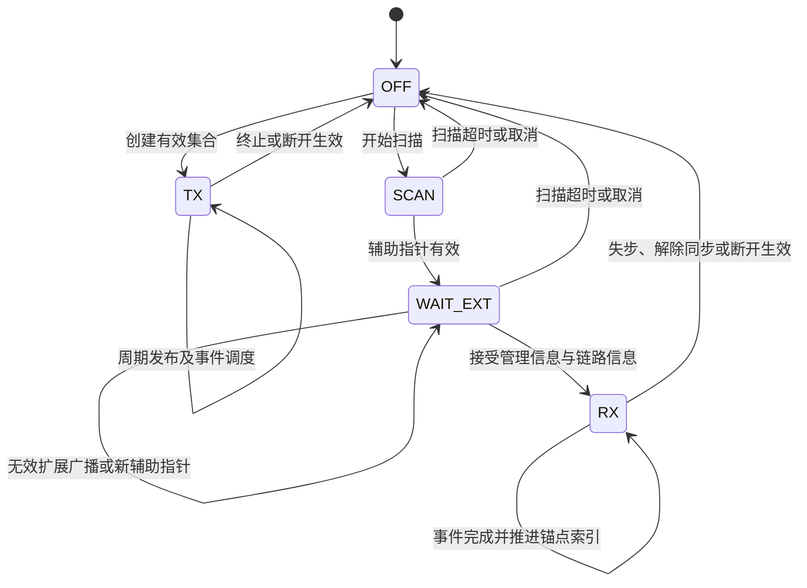
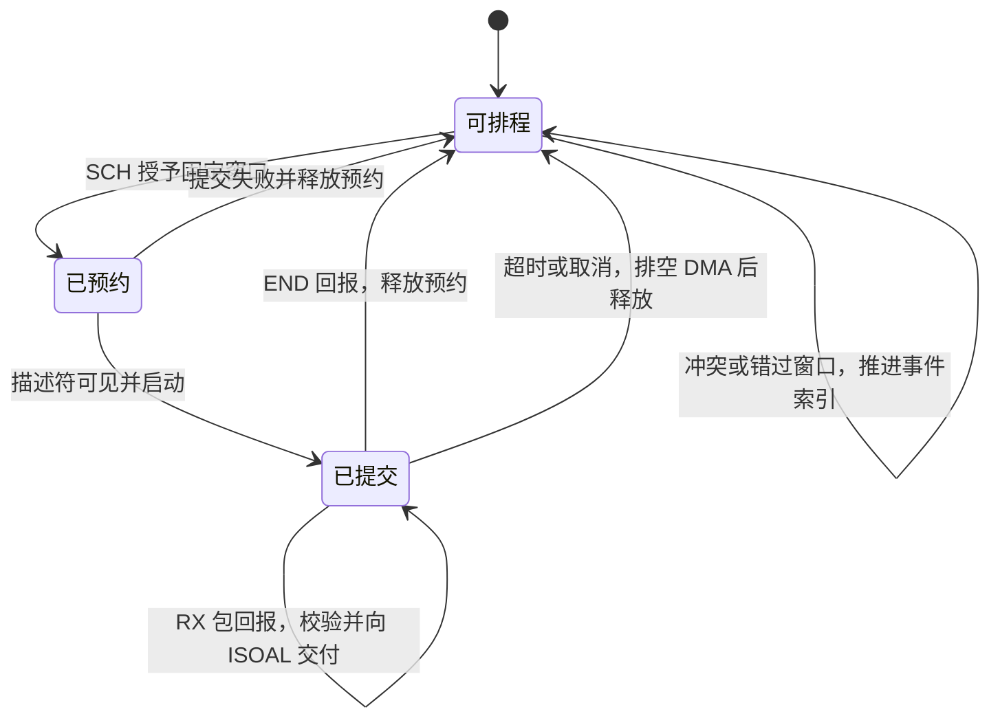

# 成员 B · SLE 非链接态同步广播控制器

开发方案、阶段验收及板级追踪表见同目录的 Word 文档。以下命令在本目录执行。

## PC 回归

PowerShell，GCC 已加入 PATH 时执行 `./run_tests.ps1`。本机也可指定 Vivado 随附的工具链：

```powershell
.\run_tests.ps1 -Compiler 'D:\vivado\Vitis_HLS\2020.2\tps\win64\msys64\mingw64\bin\gcc.exe'
```

Linux / WSL：

```sh
gcc -std=c11 -g -Wall -Wextra -Werror -pedantic -fsanitize=address,undefined sle_*.c test_bis.c -o /tmp/sle_bis_test
/tmp/sle_bis_test
```

成功标志为 `ALL TESTS PASSED`。每条 EVENT 给出描述符 token、单调目标时间（µs）、30 位空口时隙号、物理信道和 RX 已接受 PDU 数。

## 集成入口

### XSim 事件窗口仿真

在本目录运行 `.\xsim\run_xsim.ps1`。脚本先编译并运行 C 双端回归，再把四条实际输出的 RX 事件记录交给 SystemVerilog 自检平台。被测模块是单描述符事件窗口参考 RTL。描述符给出 token、目标时刻、时隙号和物理信道；RTL 锁存字段，按时产生启动脉冲，并保持完成中断直到 ACK。时隙和信道已由软件计算。

结果在 `xsim/results`。Vivado 中打开 `bis_event_window.wdb`，加载同目录 `bis_event_window.wcfg`。波形中的 `sampled_us` 是 DUT 在当前时钟沿采样的单调时间。先观察 1625 µs、1875 µs 两个采样值对应的 `radio_start` 和 `active_slot`，再检查最后四个异常描述符的 `irq_valid/irq_status/irq_ack`。状态 0、1、2、3 分别表示完成、错过、取消、超时。测试使用 1 MHz 仿真时钟；目标板的时钟域、MMIO、DMA 与真实 PHY 仍需单独验证。

### 软件与 BSP

- `sle_bis.h` 提供控制器和数据接口。每条无线队列分配一个长期存活的上下文。先调用 `bis_init`，再由同一控制任务串行处理命令、时间推进及中断回报。所有数据指针只在回调期间有效。
- 发送端用 `bis_create` 启动活动，用 `bis_aux_encode` 和 `bis_advertise_at` 为公共广播服务生成辅助指针及 0x05/0x06 TLV。后续发布须传入该次扩展广播的起始时间，函数会重新计算下一组的偏移和空口时隙。0x05 的业务内容由公共系统管理帧服务提供及消费。
- 接收端用 `bis_scan` 设置绝对截止时间，公共扫描服务把通过校验的辅助指针及扩展广播 TLV 交给 `bis_basic` 和 `bis_extended`。当前后端用准确的帧起始时间戳匹配预约窗口。板级接入需校准捕获时间、延迟和容差。
- 调度任务在每个固定窗口之前调用 `bis_schedule`，TX 从 A 的周期适配取得下一段和 A6 元数据，RX 传空指针。TX 只在返回 OK 后向 A 确认提交。MISSED、CONFLICT 和 IO 会消耗相应机会，上层按新事件索引处理数据过期。参见结构体中的 next 和 cfg.events。已提交时返回 BUSY。窗口完成前优先排空已到达的 IRQ，再以扩展单调时间调用 `bis_tick`。
- `sle_sch` 是通用单射频预约后端，可供扫描及连接式活动复用。已有平台调度器可直接绑定 reserve/release。拒绝冲突的固定窗口后，以原锚点求下一时刻。
- `sle_fpga.h` 定义 BSP 操作。控制任务反复调用 `bis_fpga_service` 直到 IDLE。PACKET 与 END 必须按硬件发生顺序交付。迟到 token 仍确认 IRQ。BSP 必须能关联原描述符，支持停止并等待 DMA 静止；若硬件仅报告槽号，复用该槽前需排空旧完成项。
- SLE 控制面按类型 0x002A 分发五字节载荷至 `bis_disconnect_pdu`；本地退订直接调用 `bis_stop`。广播服务负责撤销发布/订阅和自己的系统管理帧资源。

## 适用配置

### 活动状态图





### 协议配置与互通核对

2.4 GHz、类型 1、1 MHz、未加密、周期适配、单组单业务分组 1，调度时隙选 125 µs，每事件由软件提交一个 TX PDU。位图以物理信道号索引，PHY 将 0–75 映射至表 45 的射频信道。控制器以基础时隙起始值作为该配置下跳频的时隙计数。A6 接口提供 28 个信息位，PHY 负责余下的 CRC12 与物理传输。代码按表 37 在未加密时省略 GIV/GSKD，表 36 的本配置链路信息为 46 字节；表 26 的长度摘要为 70。该选择和位序需与目标对端抓包核验。

`test_bis.c` 含虚拟时钟、扫描/管理服务、板级收发队列，以及 A 侧周期适配测试替身。编译业务代码时仅引入 `sle_*.c`。真实板端地址、缓存维护、IRQ 清除方式、射频时钟容差、公共 ISOAL 和 HCI 合入需使用目标工程和 A 的接口版本。
